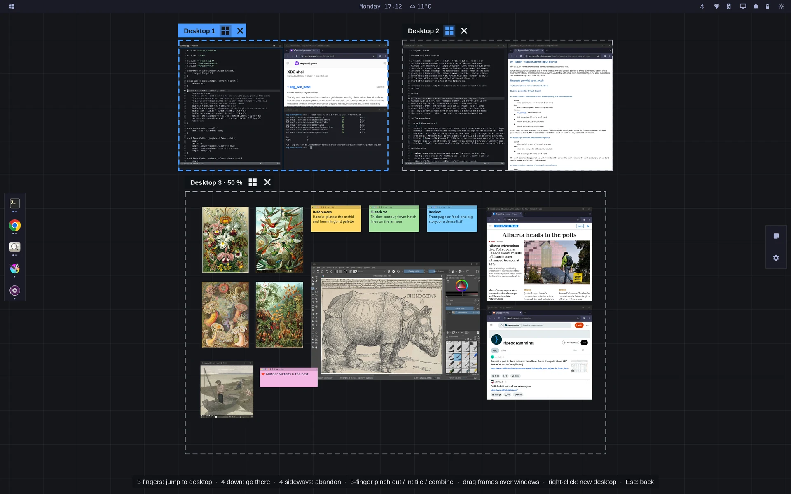
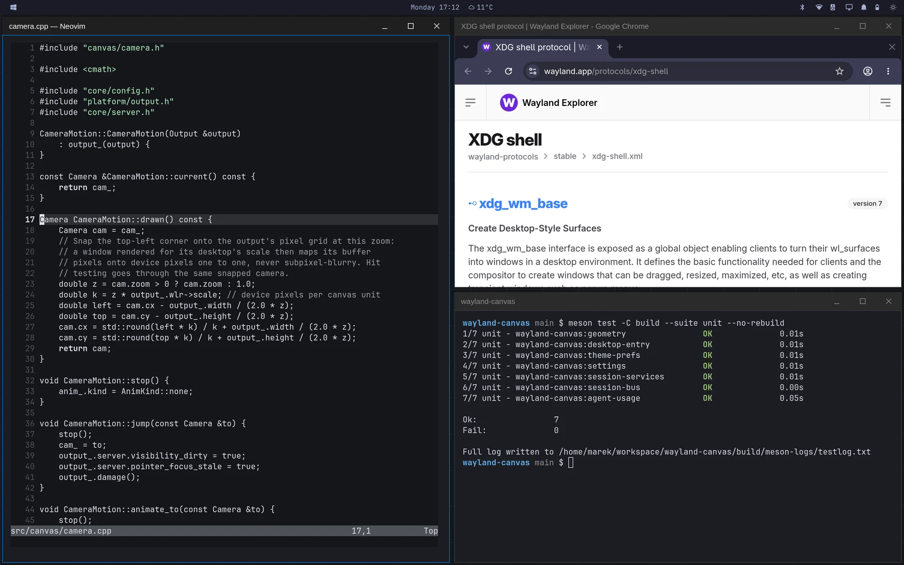
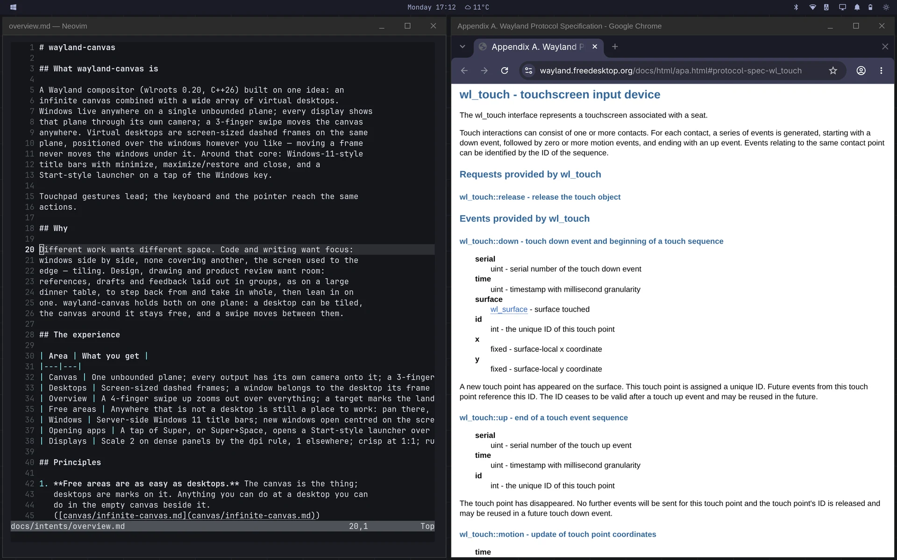
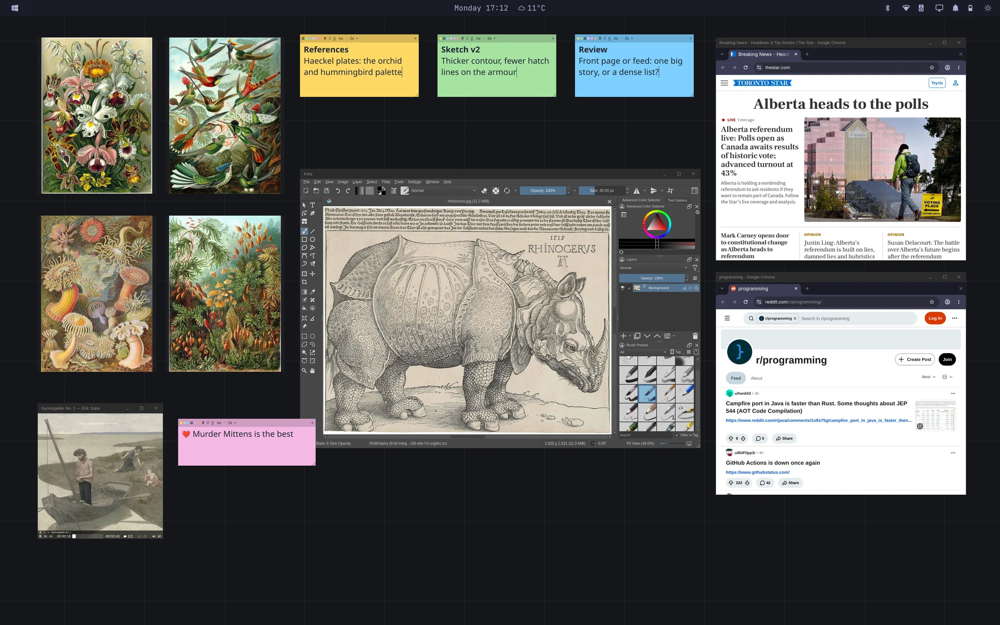

<div align="center">

# wayland-canvas

A Wayland compositor that puts tiled desktops and free space on one canvas.

[Why](#why) · [Walkthrough](#walkthrough) · [Install](#install) · [Guide](docs/guide/README.md) · [Controls](docs/guide/controls.md) · [Contributing](#contributing)



</div>

## Why

Code and writing work best tiled. Design, drawing and review need room to
spread things out, like papers on a table. wayland-canvas has both on one
canvas, and a swipe moves between them.

<br>

Tiled desktops for code and writing.

<table>
<tr>
<td width="50%"></td>
<td width="50%"></td>
</tr>
</table>

<br>

Or have a more traditional desktop where you can arrange and overlap
windows as normal, and dynamically adjust scaling/zoom or pan to change
what you want shown.

<p></p>

## Walkthrough

https://github.com/user-attachments/assets/708630ac-aa6d-41a6-a540-2d720e471fc4

## Features

- Touchpad gestures, with keyboard and mouse equivalents: [controls](docs/guide/controls.md)
- Desktops are frames on one canvas, each with its own zoom: [concepts](docs/guide/concepts.md)
- Optional app bar and extension panel: [shell](docs/guide/shell.md)
- Plugin-based architecture: [plugins](docs/guide/shell.md#plugins)
- Built-in screenshots and recordings: [capture](docs/guide/capture.md)
- Lock screen, Wi-Fi, Bluetooth, power, notification, night light and audio panels, X11 support: [session](docs/guide/session.md)
- Configurable shortcuts: [configuration](docs/guide/configuration.md)

## Install

Download the package for your distribution from the
[latest release](https://github.com/marek/wayland-canvas/releases/latest)
and install it:

```sh
sudo pacman -U wayland-canvas-*.pkg.tar.zst   # Arch and Arch-based
sudo apt install ./wayland-canvas_*.deb       # Debian and Ubuntu
```

Then pick wayland-canvas at the login screen. To build it yourself, see
[install, build and run](docs/guide/install.md).

| Gesture or keys | Action |
|---|---|
| 4-finger swipe up, or Super+Tab | Overview |
| 3-finger swipe, or Super+Ctrl+arrows | Hop to the next desktop that way |
| Super + 2-finger pinch | Zoom the desktop |
| Super+Space | Launcher |
| Super+Return | Terminal |
| Super+T | Tile the desktop |
| Super+arrows | Move a window through the tiles |

All controls: [controls](docs/guide/controls.md).

## Documentation

The [guide](docs/guide/README.md) covers installing, the concepts, controls,
configuration, apps, the shell, capture, the session, compatibility and
development.

## Contributing

wayland-canvas is built by agentic development with intents, tests and
implementation. Start with [AGENTS.md](AGENTS.md) and
[development](docs/guide/development.md).

## License

[Apache-2.0](LICENSE).
